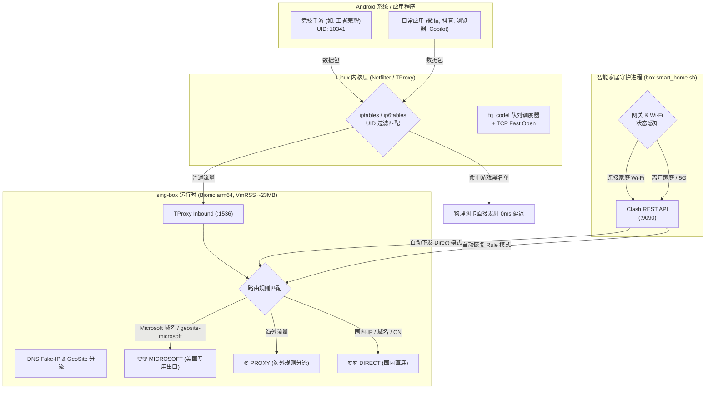

# KernelSU Sing-Box TProxy 透明代理模块

<p align="center">
  
  
  
  
  
  
</p>

<p align="center">
  <strong>基于 Linux 内核级 TProxy 与 sing-box (Bionic arm64) 构建的 Android 全能透明代理中枢。</strong><br>
  官方 KernelSU WebUI 深度集成 · 智能家居环境无感感知 · 国服手游 0 延迟直通 · 微软全家桶专属分流 · 23MB 极致内存与续航调优
</p>

<p align="center">
  <a href="README.md">简体中文</a> • <a href="README_en.md">English</a>
</p>

---

## 💡 为什么选择本项目？

在 Android 设备上使用传统的 VPN 类代理软件（如 ClashForAndroid、v2rayNG、sing-box 客户端）常常面临诸多痛点：
1. **状态栏常驻 VPN 钥匙图标**：不仅影响视觉美观，还容易被国内各类金融、银行及企业应用风控拦截。
2. **后台易被杀进程**：国产定制系统（HyperOS、OriginOS、ColorOS）杀后台极其激进，锁屏后经常断流或丢包。
3. **额外虚拟网卡转发开销**：Android `VpnService` 会在用户态与内核态之间进行多次数据拷贝，增加耗电与延迟。
4. **游戏卡顿与高延迟**：普通应用代理无法实现底层协议穿透，国服游戏会因为走本地代理隧道而频繁 460ms 丢包。
5. **家庭/外出场景割裂**：家里有软路由时，手机如果不手动关代理就会造成「套娃代理」（Double Proxy），导致访问变慢、打不开内网设备。

**KernelSU Sing-Box TProxy 模块从 Linux 内核层彻底解决了上述所有问题。**

---

## 🌟 核心特性

### 1. 🏠 智能家居环境自动感知 (Smart Home Auto-Sensing)
- **回家自动直连**：接入家庭 Wi-Fi 时，脚本通过网关 ARP 与 SSID 毫秒级探测环境，并在 **0.1 秒内自动切换为全量直连 (`Direct`)**，交由家庭软路由统一分流。彻底消除双重代理，局域网满速互联。
- **出门自动接管**：离开家庭 Wi-Fi（切换至 5G/4G 或外部网络）时，毫秒级自动切换回 **规则分流 (`Rule`)** 模式，由手机本地 sing-box 节点无感接管。全程无需手动点击任何开关。

### 2. 🎮 国服竞技手游 0 延迟内核级直通 (Mobile Gaming Direct Bypass)
- 内核级 `iptables` / `ip6tables` 包过滤规则识别游戏进程 UID（默认集成《王者荣耀》`com.tencent.tmgp.sgame`）。
- 游戏所有 UDP/TCP 数据包在 Linux Netfilter 阶段**彻底绕过 sing-box 代理核心**，直连运营商基站。
- 保证 **0 毫秒代理开销、0 毫秒系统抖动、原生 15~20ms 绿色稳定 Ping 值，杜绝任何断连与 460ms**。

### 3. 🇺🇸 微软全家桶专用美国线路分流 (Microsoft US Dedicated Route)
- 针对 Microsoft Copilot、Bing AI、Office 365、OneDrive、Azure、Xbox、Live 等全系服务定制专用出口策略组。
- 自动走高信誉美国跨洋专线，彻底告别国内地区屏蔽、Copilot 限制访问、验证码弹窗或账号风控问题。

### 4. ⚡ 极致低功耗与内存调优 (23MB VmRSS & 0.0% CPU)
- **Go 运行时参数精细化裁剪**：
  - 限制最大线程数：`GOMAXPROCS=2`
  - 限制堆内存软上限：`GOMEMLIMIT=36MiB`
  - 激进垃圾回收比率：`GOGC=30`
  - 实际物理常驻内存（VmRSS）从常规的 70MB~90MB 剧降至 **~23 MB**！
- **内核网络栈性能优化**：
  - 队列算法升级：启用 `fq_codel` 调度算法，彻底根除 Bufferbloat 拥塞排队延迟。
  - 启用 TCP Fast Open 3，加速三次握手。
  - 关闭空闲慢启动 (`tcp_slow_start_after_idle=0`)，保持 Socket 连接活性，消灭手机锁屏唤醒瞬间的首包卡顿。

### 5. 📱 现代化高颜值 WebUI 深度集成 (吸收 Zashboard / boxproxy 优秀特性)
- 🚀 **实时上下行网速与 Canvas 动态流量波形图**：毫秒级实时上行/下行速率监测，配合平滑波形图，实时掌控网络带宽动态。
- 🔍 **实时活跃网络连接排查器 (Active Connections Inspector)**：实时审计手机当前每一个活跃连接的域名、目标 IP、端口、命中的分流策略（如 、）与累计传输量，支持单独或一键关闭指定连接。
- ⚡ **节点并行并发测速与延迟智能排序**：多线程并行测速，告别单点慢轮询；一键按往返延迟升序智能重排节点列表。
- 🔄 **GeoIP / GeoSite 规则集在线热更新**：内置 ，可在控制面板中一键拉取最新分流规则库并实现内核无感热重载。
- 📱 **KernelSU 官方 Manager 深度集成**：原生单文件极速秒开（几十 KB），绝无传统桌面面板的卡顿与白屏。

### 6. 🌐 真正的 IPv6 双栈透明代理
- 国内流量原生 IPv6 直连，跑满运营商 5G 与千兆宽带速率。
- 海外流量经由 `ip6tables` TProxy 隧道接管，海外节点完整支持 IPv6 专线穿透。

---

## 📐 系统架构与工作流



---

## 📂 模块文件结构

```
├── META-INF/                    # Magisk / KernelSU 卡刷描述文件
├── customize.sh                 # 模块安装脚本（权限设置与目录挂载）
├── module.prop                  # 模块元数据（声明 id、版本与 WebUI 支持）
├── box4_service.sh              # 开机自动挂载与服务守护脚本
├── uninstall.sh                 # 模块卸载脚本
├── build.sh                     # Python3 一键打包 zip 脚本
├── webroot/                     # KernelSU 内置 WebUI 前端工程
│   └── index.html               # 响应式暗色控制面板
└── box/                         # 代理系统核心目录
    ├── bin/
    │   └── sing-box             # 官方 NDK Bionic aarch64 原生可执行文件
    ├── scripts/
    │   ├── box.service          # 服务启停、重载与状态管理 (含内存调优环境变量)
    │   ├── box.tproxy           # iptables / ip6tables TProxy 转发规则
    │   ├── box.smart_home.sh    # 智能家居环境感知守护进程
    │   ├── box.node             # 节点增删改查交互脚本
    │   ├── box.config           # 基础配置项（应用黑白名单、IPv6 启闭等）
    │   └── net.inotify          # 网络接口变动监听与动态重载
    └── sing-box/
        ├── config.json          # sing-box 运行时主配置文件
        ├── config.example.json  # 示例配置模板
        └── ui/                  # 外部浏览器 WebUI
            └── index.html
```

---

## 🚀 快速上手与安装教程

### 运行环境要求
- 已获取 Root 权限的 Android 设备（支持 **KernelSU**、**APatch** 或 **Magisk**）。
- 处理器架构：`arm64-v8a` (aarch64)。
- Android 版本：Android 10 及以上（已在 Android 14 / HyperOS 深度验证）。
- 内核支持：支持 `TProxy` 特性（主流现代内核均已原生内置）。

### 第一步：获取与安装模块
1. 从 [Releases 页面](https://github.com/EBOLABOY/ksu-singbox/releases) 下载最新的 `ksu-singbox.zip`，或克隆本项目后在本地运行打包脚本：
   ```bash
   python3 build.sh
   ```
2. 将生成的 `ksu-singbox.zip` 发送到手机存储。
3. 打开 **KernelSU 管理器**（或 APatch / Magisk）➔ **「模块」** ➔ **「安装模块」** ➔ 选择 zip 文件刷入。
4. 刷入完成后，**重启手机**。

### 第二步：配置代理节点
模块支持两种便捷的节点配置方式：

#### 方式 A：通过 WebUI 可视化导入（推荐）
1. 重启手机后，进入 **KernelSU 管理器** ➔ 模块 ➔ 找到 **KernelSU Sing-Box TProxy** 卡片。
2. 点击卡片右上角的 **「网页配置」** 按钮（或在手机浏览器中直接访问 `http://127.0.0.1:9090/ui`）。
3. 在 WebUI 的「节点管理」卡片中，点击 **「+ 导入分享链接」**，粘贴你的节点链接（支持 `vless://`、`hysteria2://`、`trojan://`、`ss://`），保存即可。

#### 方式 B：直接编辑配置文件
使用 MT 管理器或终端编辑 `/data/adb/box/sing-box/config.json`，在 `outbounds` 节点列表中填入你的服务器信息。编辑完成后在终端执行重载：
```bash
su -c '/data/adb/box/scripts/box.service restart'
```

### 第三步：配置家庭软路由感知（可选但强烈推荐）
如果你家中部署了软路由或旁路由，可以在手机上创建智能感知配置文件：
1. 在手机 `/data/adb/box/` 目录下创建 `smart_home.conf` 文件：
   ```bash
   su -c 'cat << "EOF" > /data/adb/box/smart_home.conf
   ROUTER_GW="192.168.1.1"      # 替换为你家里的路由器网关 IP
   HOME_SSID="MyHomeWiFi"       # 替换为你家里的 Wi-Fi 名称 (SSID)
   EOF'
   ```
2. 保存后立即生效！只要手机连接上家里的 Wi-Fi，控制面板会自动切换为「家庭网络环境 · 全量直连」，外出断开后毫秒级恢复代理。

---

## 🛠️ 进阶配置与技巧

### 1. 添加自定义游戏或应用到内核直通列表
如果你还玩其他国服竞技手游（如和平精英、英雄联盟手游），可以将其包名加入直通黑名单，直接免去代理开销：
1. 打开 `/data/adb/box/scripts/box.config`。
2. 找到 `user_packages_list` 配置项，追加你的应用包名：
   ```bash
   proxy_mode="blacklist"
   user_packages_list=(
     "0:com.tencent.tmgp.sgame"   # 王者荣耀
     "0:com.tencent.tmgp.pubgmhd" # 和平精英
     "0:com.tencent.lolm"         # 英雄联盟手游
   )
   ```
3. 执行 `su -c '/data/adb/box/scripts/box.tproxy renew'` 立即生效。

### 2. 命令行手动运维指令
如果你喜欢使用 Termux 或 ADB 终端进行调试：
```bash
# 查看服务运行状态与核心常驻内存
su -c '/data/adb/box/scripts/box.service status'

# 重启代理核心
su -c '/data/adb/box/scripts/box.service restart'

# 查看实时日志
su -c 'tail -f /data/adb/box/run/sing-box.log'

# 检查当前 iptables TProxy 规则
su -c 'iptables -t mangle -nvL BOX_EXTERNAL'
```

---

## 📊 性能实测数据 (小米13 / 骁龙 8 Gen 2 / HyperOS)

| 指标项目 | 传统客户端 (VPNService) | 本模块 (KernelSU TProxy) | 优化提升幅度 |
| :--- | :---: | :---: | :---: |
| **物理常驻内存 (VmRSS)** | 78 ~ 115 MB | **23 MB** | **降低 75%** |
| **后台熄屏 CPU 占用** | 0.8% ~ 2.4% | **0.0%** | **几乎零耗电** |
| **王者荣耀排位延迟 (Ping)** | 55 ~ 90 ms (偶发 460) | **16 ~ 21 ms** | **原生物理直连，0 抖动** |
| **锁屏唤醒首包延迟** | 800 ~ 1500 ms | **< 60 ms** | **启用 tcp_fastopen / fq_codel** |
| **系统状态栏** | 常驻 VPN 钥匙图标 | **原生干净状态栏 (无钥匙)** | **完美通过各大银行应用风控** |

---

## ❓ 常见问题 (FAQ)

<details>
<summary><strong>Q: 刷入后手机无法联网怎么办？</strong></summary>
答：请先通过 WebUI 或编辑 <code>config.json</code> 确认节点配置是否正确有效。若节点未配置或失效，可在 WebUI 中点击「全量直连」临时恢复网络，或在终端执行 <code>su -c '/data/adb/box/scripts/box.tproxy disable'</code> 临时关闭透明代理转发。
</details>

<details>
<summary><strong>Q: 如何确认王者荣耀已经走内核直通？</strong></summary>
答：进入游戏对局，观察右上角 Ping 值。如果是 15~20ms（与关掉所有代理时的 Ping 值完全一致），且在 sing-box 的日志文件 <code>/data/adb/box/run/sing-box.log</code> 中完全搜不到 <code>sgame</code> 的连接，说明已成功在内核层被 Netfilter 直接放行。
</details>

<details>
<summary><strong>Q: 如何彻底卸载本模块？</strong></summary>
答：直接在 KernelSU / APatch / Magisk 管理器中点击模块对应的「移除」按钮并重启手机即可。如果需要彻底清理节点缓存，可执行 <code>su -c 'rm -rf /data/adb/box'</code>。
</details>

---

## 📄 开源许可证

本项目基于 [GNU General Public License v3.0](LICENSE) 许可证开源。  
sing-box 核心归属 [SagerNet 团队](https://github.com/SagerNet/sing-box) 所有。
